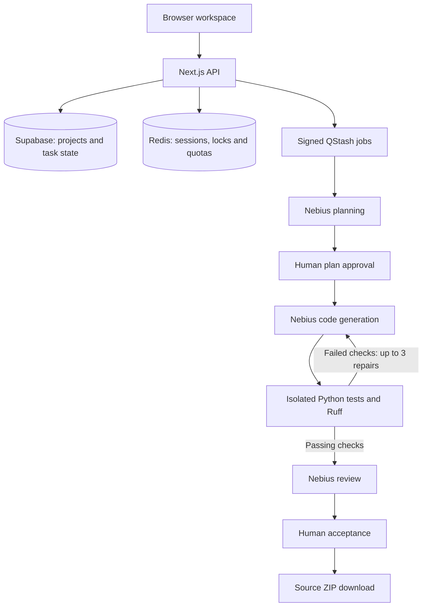

**An AI coding workspace powered by Nebius Token Factory.**

Turn a Python project brief into an approved plan, generated source, isolated test results, and a reviewed source download. CodeForge includes nine guided projects and opens a private browser workspace automatically—no account or sign-in required.

[Live demo](https://nebius-codeforge-ai.vercel.app) · [Explore guided projects](https://nebius-codeforge-ai.vercel.app/case-studies) · [Repository](https://github.com/HelloAGit/CodeForge)

## What you can do

- Create projects and submit your own development tasks.
- Start from a guided brief with a fixed interface and protected acceptance tests.
- Discover available Nebius models and choose a model for your task.
- Review and approve the plan before code generation begins.
- Run Python tests and Ruff in an isolated runner, with up to three repair attempts.
- Inspect source, diffs, test output, model usage, and the generated review.
- Rerun tests, reject a result, retry a failed task, or accept and download a source ZIP.
- View task completion, timing, and repair metrics from recorded activity.

Runtime model calls use Nebius-hosted models. Generated implementations and passing test outcomes are never prefilled; the guided acceptance tests are authored starter files that the model cannot change.

## Try it

1. Open the [guided project library](https://nebius-codeforge-ai.vercel.app/case-studies).
2. Choose a project and edit its brief while keeping the required interface.
3. Select **Generate plan**, inspect the requirements, and approve the plan.
4. Follow generation, isolated testing, and any repairs in the task timeline.
5. Review the source and actual results, then accept and download the ZIP.

Your workspace is remembered by a protected browser cookie. Keep using the same browser to return to saved projects. Clearing cookies or switching browsers removes access to that workspace; download work you want to retain.

## Nine guided projects

| Project | What it teaches |
| --- | --- |
| Compound-interest API | FastAPI validation, numeric edge cases, and rounding |
| CSV contact cleaner | Normalization, rejected records, deduplication, and safe export |
| Signed webhook verifier | HMAC signatures, timestamp boundaries, and constant-time comparison |
| Expense splitter | Integer-cent calculations and deterministic remainder allocation |
| Structured log redactor | Recursive JSON transformations and preserving original data |
| Inventory movement ledger | Ordered updates, stock invariants, and atomic failure handling |
| Markdown outline extractor | Heading parsing, code fences, Unicode, and unique anchors |
| Exponential retry planner | Capped delays, overflow handling, and separating policy from execution |
| Booking conflict detector | Half-open intervals, stable pair ordering, and input validation |

Each guide supplies an editable brief, a walkthrough, acceptance checkpoints, a dedicated project name, and immutable tests. The six small utility guides recommend Nebius-hosted Qwen3-235B-A22B-Instruct-2507; the original three recommend Kimi-K2.7-Code. Model availability depends on the configured Nebius account, and users can select another available model.

## Architecture

The deployed application uses the managed Next.js adapter:



| Component | Technology |
| --- | --- |
| Web interface and API | Next.js App Router, React, TypeScript |
| Source viewer and charts | Monaco Editor, Recharts |
| Runtime models | Nebius Token Factory |
| Persistent data | Supabase PostgreSQL |
| Coordination and background delivery | Upstash Redis, QStash |
| Managed execution | Vercel Sandbox with a digest-pinned image |
| Generated project checks | Python, pytest, Ruff |
| Alternative backend components | FastAPI, Redis/RQ, dedicated Docker runner |

The Python backend remains available under `services/`. The deployed browser workflow uses the managed adapter; it does not need a separately hosted FastAPI worker.

## Repository layout

```text
CodeForge/
├── apps/web/                  # Dashboard, API, guided briefs and starter tests
├── packages/shared/           # Shared task and workflow types
├── services/
│   ├── orchestrator/          # Alternative FastAPI/RQ backend
│   └── runner/                # Trusted execution controllers and image definitions
├── supabase/migrations/       # Database schema and row-level security
├── scripts/                   # Setup, migration and real integration checks
├── docs/                      # Verification evidence and setup notes
├── .github/workflows/         # CI checks
├── .env.example               # Configuration template; no real credentials
├── docker-compose.yml        # Alternative backend services
└── package.json              # npm workspace commands
```

## Run locally

Use Node.js 22.12 or newer. Python 3.12 is the reference version for the Python services and CI. Full agent execution requires your own configured services and credentials; cloning the repository does not provide access to the hosted app's secrets or runner image.

```bash
git clone https://github.com/HelloAGit/CodeForge.git
cd CodeForge
npm ci
```

Create the ignored file `apps/web/.env.local` using the managed settings below. The root `.env.example` also includes alternative-backend settings; leave `ORCHESTRATOR_URL` unset when using the managed adapter.

| Server-only setting | Purpose |
| --- | --- |
| `NEBIUS_API_KEY` | Nebius inference and model discovery |
| `SUPABASE_URL` | Your Supabase project URL |
| `SUPABASE_SECRET_KEY` | Server access to persistence and browser workspace creation; legacy `SUPABASE_SERVICE_ROLE_KEY` is also supported |
| `KV_REST_API_URL`, `KV_REST_API_TOKEN` | Redis REST connection |
| `QSTASH_TOKEN` | Background job publishing |
| `QSTASH_CURRENT_SIGNING_KEY`, `QSTASH_NEXT_SIGNING_KEY` | Job signature verification |
| `CODEFORGE_PUBLIC_URL` | Public HTTPS application origin reachable by QStash |
| `CODEFORGE_RUNNER_IMAGE` | Your immutable managed image reference, `codeforge-python@sha256:...` |

Optional settings include `NEBIUS_BASE_URL`, `NEBIUS_MODEL`, and `NEBIUS_USD_PER_MILLION_TOKENS`. Without an explicitly configured token rate, estimated cost is reported as unknown. Local managed-runner execution also requires valid Vercel Sandbox credentials.

`NEXT_PUBLIC_SUPABASE_URL` and `NEXT_PUBLIC_SUPABASE_ANON_KEY` support legacy local-account migration. They are public client configuration, never a place for service-role or Nebius secrets. New browser workspaces do not require users to enter credentials.

Before running real tasks:

1. Provision Supabase and apply `supabase/migrations/001_initial.sql`. See [Supabase setup](docs/supabase-setup.md). The migration script supports transactional application with `python scripts/migrate.py --apply` after setting a TLS-enabled `DATABASE_URL` in the root ignored `.env`.
2. Configure Redis REST and QStash credentials.
3. Build and register your managed runner image using `services/runner/Dockerfile.managed` and the setup tooling in `scripts/`. The bootstrap script uses deployment-specific Vercel registry references; adapt those references to your own project. Do not execute generated source directly on the development host.
4. Use a public HTTPS callback URL for QStash. A local-only URL is not reachable by the job service; full local workflow testing needs a configured public callback deployment or tunnel using the same database and queue.

```bash
npm run dev
# http://127.0.0.1:3000
```

The interface can render before services are configured. Saving projects and running agents require the configured backend services; missing dependencies produce errors rather than simulated results.

## Deploy to Vercel

1. Import `HelloAGit/CodeForge` into your Vercel account.
2. Set the project root directory to `apps/web`, keeping the monorepo workspace structure intact.
3. Provision Supabase, Redis and QStash, then add the server-only configuration above to the intended environment.
4. Configure Sandbox access and a digest-pinned execution image for your project.
5. Set `CODEFORGE_PUBLIC_URL` to your deployment's public HTTPS origin, deploy, and verify `/api/health` and a real guided task.

`/api/health` reports configuration presence; it is not a comprehensive live-service check. Generated Python runs inside the isolated runner, never inside a Vercel function. Provisioning integrations and deploying from GitHub are separate from enabling runtime pull-request publishing.

## Execution and workspace controls

- Plans require approval before code generation; final acceptance is a separate decision.
- Managed execution uses a one-use microVM with denied networking and no application credentials passed to generated Python.
- The generated process runs as a non-root user against read-only source, with process, file, CPU and memory limits.
- The managed VM has 1 CPU and 2 GB memory; the Python process has a separate 256 MB address-space limit and a 30-second execution deadline.
- Browser workspace capabilities use random 256-bit values in HttpOnly, SameSite=Lax cookies, with Secure on HTTPS and a 180-day lifetime. Redis stores their hashes, and projects retain owner isolation.
- Cross-origin writes, forged cookies and foreign-project access are rejected.
- Workspace creation, model actions and runner executions are bounded. The current managed trial has a lifetime cap of 100 test/lint executions; this is not a dollar billing guarantee.

## Verification

Recorded checks as of **28 October 2026**:

- **78 unit/UI tests passed:** 48 frontend, 24 orchestrator and 6 runner tests.
- Frontend lint, TypeScript checking, local/remote production builds, and Python Ruff checks passed.
- The three original guides and six additions completed real model-and-runner workflows. The six additions produced **91 passing acceptance tests**, with review, acceptance and ZIP export verified.
- Real cookie-only checks covered workspace persistence, visitor isolation, forged-cookie rejection and cross-origin protection.

These are recorded results, not a claim that every future model output or deployment will pass. Mocked unit tests and real integrations are identified separately. Visual browser automation was unavailable on the build machine; HTTP integration and component tests were used.

Evidence: [verification report](docs/verification.md), [original guided workflows](docs/cloud-workflow-verification.json), [six additional guides](docs/additional-guides-verification.json), and [account-free workflow](docs/browser-workspace-verification.json).

# CodeForge

Nebius Code Forge.

## Deployed URL

https://nebius-codeforge-ai.vercel.app/](https://nebius-codeforge-ai.vercel.app/

# CodeForge

Run the regular checks from the repository root:

```bash
npm run lint
npm run typecheck
npm test
npm run build

python -m pip install -r services/orchestrator/requirements.txt
python -m ruff check services
cd services/orchestrator
python -m pytest -m "not integration"
cd ../runner
python -m pytest -m "not integration"
```

Live verification scripts in `scripts/` create real model requests and may consume provider or runner credits. Review their deployment references and configuration before running them against your own services.

## Current limitations

- The hosted application exports reviewed source as a ZIP. Runtime GitHub pull-request publishing is not configured. The alternative orchestrator contains integration code that requires a scoped installation token, an allowed repository and explicit approval.
- Browser workspaces are scoped to a cookie; cross-device recovery and team membership are not implemented.
- The source viewer is read-only. Importing and editing existing repositories is outside the current workflow.
- Model requests may fail or time out. Three repairs are a limit, not a guarantee of a passing implementation.
- Model reviews and passing tests still require human judgment before using generated software.
- This is a working prototype, not a completed production security, reliability or load audit. Backups, monitoring, recovery and operating budgets need deployment-specific configuration.

## License

No project license has been activated. A proposed MIT license is available at [docs/LICENSE-MIT-DRAFT.txt](docs/LICENSE-MIT-DRAFT.txt); it remains a draft pending the repository owner's decision.
